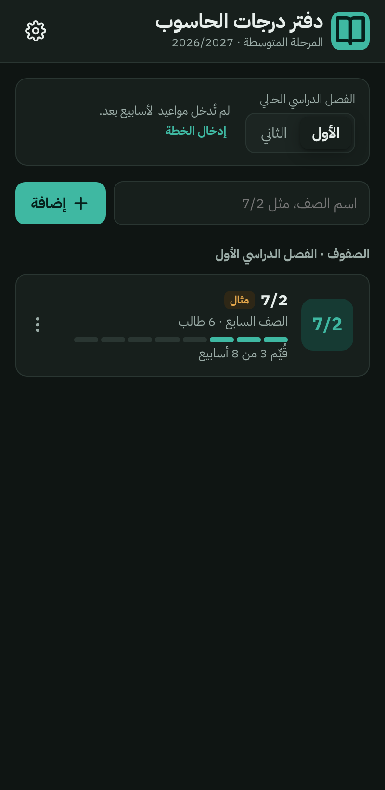
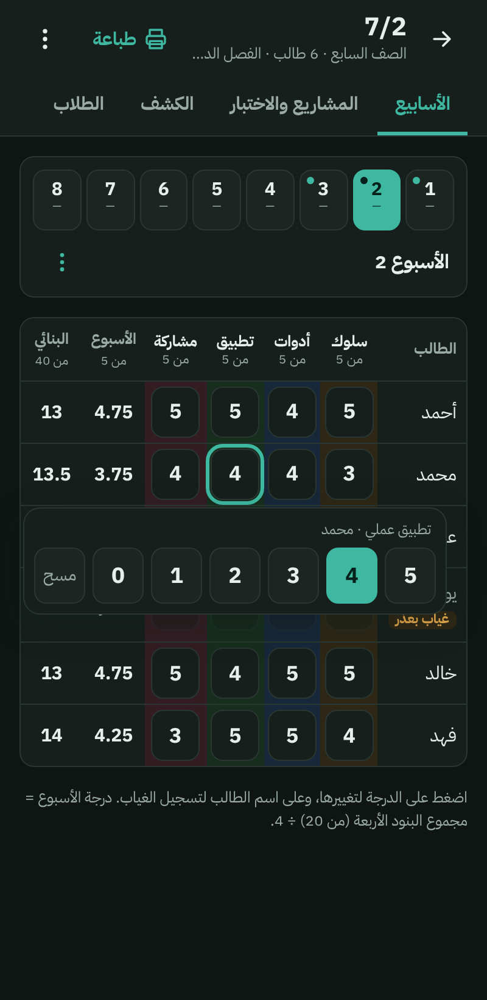
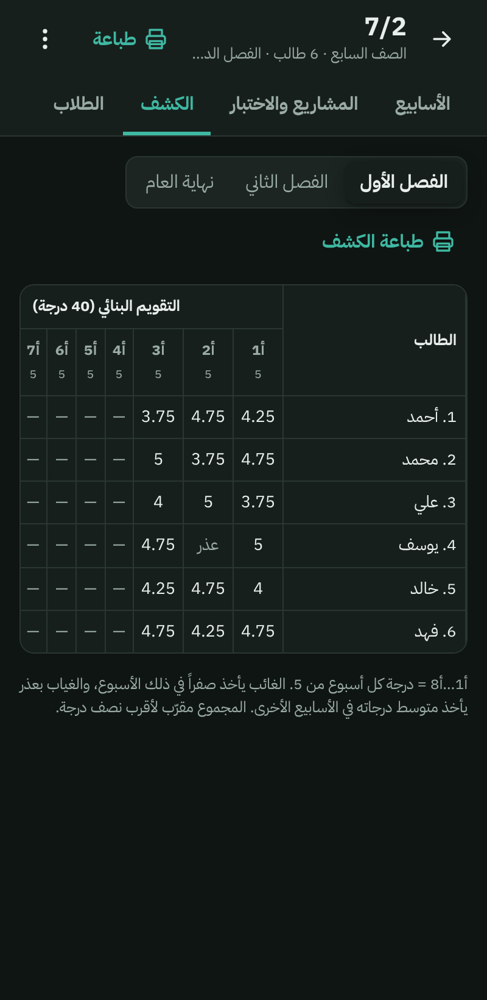
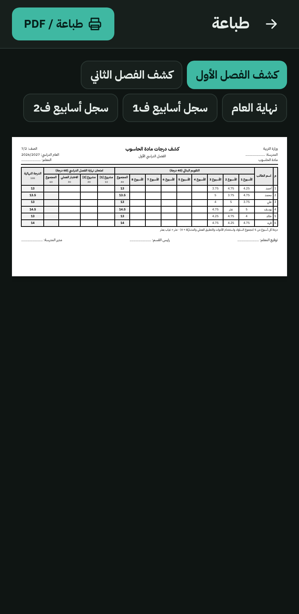

# دفتر درجات الحاسوب

تطبيق أندرويد لمعلمي الحاسوب في المرحلة المتوسطة (الصفوف 6–9) لرصد درجات الطلاب على الهاتف بدلاً من الورق، حسب توزيع درجات مادة الحاسوب المعتمد من وزارة التربية.

## ⬇️ تنزيل التطبيق

**[اضغط هنا لتنزيل أحدث نسخة](https://github.com/Heavensfeel3/gradebook-obada/releases/latest)**، ثم اضغط على ملف **GradeBook.apk** في أسفل الصفحة.

هذا الرابط يفتح دائماً أحدث نسخة، فاحفظه عندك.

  
  
  
  

---

## التثبيت لأول مرة

1. افتح [رابط التنزيل](https://github.com/Heavensfeel3/gradebook-obada/releases/latest) من هاتفك، واضغط **GradeBook.apk**.
2. بعد اكتمال التنزيل افتح الملف.
3. سيقول أندرويد إن التثبيت من هذا المصدر غير مسموح. اضغط **الإعدادات** وفعّل **«السماح من هذا المصدر»**، ثم ارجع.
   هذا طبيعي لأن التطبيق ليس من متجر Google Play.
4. اضغط **تثبيت**، وسيظهر التطبيق باسم **«دفتر الدرجات»**.
5. إذا ظهرت رسالة من **Play Protect** فاضغط **«تثبيت على أي حال»**.

يحتاج التطبيق أندرويد 8 أو أحدث، ويعمل بدون إنترنت. يستخدم الإنترنت فقط للتحقق من وجود إصدار جديد.

## الإعداد في أول استخدام

1. اضغط ⚙️ **الإعدادات** في أعلى الصفحة الرئيسية:
   - اكتب **اسمك** و**اسم المدرسة** و**العام الدراسي**، لتظهر في الكشوف المطبوعة.
   - اختر **المظهر**: داكن (الأساسي) أو فاتح أو حسب الهاتف.
2. اضغط **«إدخال الخطة»** وأدخل تاريخ بداية كل أسبوع من الأسابيع الثمانية لكل فصل دراسي. إذا كانت الأسابيع متتالية، أدخل تاريخ الأسبوع الأول واضغط **«تعبئة 8 أسابيع متتالية»**.
3. احذف الصف التجريبي **«7/2 مثال»**: اضغط ⋮ بجانبه ثم **حذف الصف**.
4. أضف صفوفك: اكتب اسم الصف (مثل `7/2`) واضغط **إضافة**.
5. افتح الصف، ثم أضف الطلاب من تبويب **الطلاب** (انظر القسم التالي).

## إضافة الطلاب

من تبويب **الطلاب** في الصف، بإحدى ثلاث طرق:

**1. من صورة قائمة المدرسة 📷**
1. اضغط **«قراءة الأسماء من صورة»**، ثم صوّر القائمة بالكاميرا أو اخترها من المعرض.
2. اضغط **«قراءة الأسماء»**. القراءة تتم على الهاتف نفسه خلال ثوانٍ، ولا تُرفع الصورة إلى أي مكان.
3. يجد التطبيق صفوف الطلاب من الرقم المدني، ويختصر كل اسم إلى **الاسم الأول والثاني والعائلة**.
   مثال: «أحمد يوسف فرحان جفيل» ← «أحمد يوسف جفيل».
4. **راجع القائمة وصحّح الأخطاء** قبل الإضافة: القراءة الآلية للعربية قد تخطئ في بعض الحروف أو تُسقط اسماً. يمكنك تعديل أي اسم أو حذفه، أو إلغاء الاختصار.
5. اضغط **«إضافة … طالب»**.

نصائح لقراءة أفضل: صوّر الورقة كاملة ومستقيمة، بإضاءة جيدة وبدون ظل. إذا كانت الصورة مقلوبة أو جانبية فالتطبيق يجرّب الاتجاهات تلقائياً، ويمكنك أيضاً الضغط على **«تدوير»**.

**2. من Google Lens (الأدق)**
1. افتح صورة القائمة في Google Lens واختر **نص** ← **نسخ**.
2. الصق النص في مربع الأسماء في التطبيق واضغط **إضافة**.

يحذف التطبيق الأرقام المدنية وعمود الجنس، ويختصر الأسماء بالطريقة نفسها.

**3. كتابة أو لصق الأسماء**
اكتب اسماً في كل سطر واضغط **إضافة**.

## طريقة التقييم

يتبع التطبيق توزيع درجات مادة الحاسوب، لكل فصل دراسي من 100 درجة:

| الجزء | الدرجة |
|---|---|
| التقويم البنائي: 8 أسابيع × 5 درجات | 40 |
| مشروع [1]: مشروع حاسوبي روبوت | 10 |
| مشروع [2]: مشروع حاسوبي نهائي | 20 |
| الاختبار العملي | 30 |
| **الدرجة النهائية للفصل** | **100** |
| **الدرجة الكلية لنهاية العام** | **(الفصل الأول + الفصل الثاني) ÷ 2** |

**درجة الأسبوع:** كل أسبوع تقيّم الطالب في أربعة بنود، كل بند من 5:
السلوك، استخدام الأدوات، تطبيق عملي، المشاركة.
درجة الأسبوع = مجموع البنود (من 20) ÷ 4، فتكون من 5. ومجموع الأسابيع الثمانية هو درجة التقويم البنائي من 40.

**الغياب:**
- **غائب:** يأخذ الطالب صفراً في ذلك الأسبوع.
- **غياب بعذر:** لا يُحتسب ذلك الأسبوع، ويأخذ الطالب فيه متوسط درجاته في الأسابيع الأخرى.

## الاستخدام في الحصة

1. افتح الصف، فيظهر **الأسبوع الحالي** تلقائياً حسب الخطة.
2. اضغط **«إعطاء الجميع 5 ثم التعديل»** لتبدأ كل الدرجات بالدرجة الكاملة.
3. عدّل فقط من يحتاج: اضغط على الدرجة واختر من 0 إلى 5.
4. لتسجيل الغياب اضغط على **اسم الطالب** واختر «غائب» أو «غياب بعذر».
5. للتعامل مع عمود كامل، اضغط على **اسم البند** في رأس الجدول (مثلاً لإعطاء الجميع 5 في السلوك).

الحفظ تلقائي، ولا يوجد زر حفظ.

**المشاريع والاختبار:** من تبويب **«المشاريع والاختبار»** اكتب الدرجات مباشرة. الدرجة الأعلى من الحد الأقصى تظهر باللون الأحمر ولا تُحفظ.

**الكشف:** تبويب **«الكشف»** يحسب كل شيء تلقائياً للفصل الأول والفصل الثاني ونهاية العام.

## متابعة الطلاب

**ملاحظات سريعة:** في صفحة الأسابيع اضغط على اسم الطالب ← **إضافة ملاحظة** ← اختر «سلبية» أو «إيجابية» ثم اختر من الملاحظات الجاهزة (كثير الكلام، لم يحضر أدواته، مشارك متميز…) أو اكتب ملاحظتك.

**بطاقة الطالب:** من تبويب **الطلاب** اضغط على اسم الطالب: درجات الفصل أسبوعاً بأسبوع، والغياب، وكل الملاحظات وتقارير السلوك. زر **PDF** يطبع البطاقة لاجتماع ولي الأمر أو المرشد الطلابي. ومن البطاقة نفسها تعدّل الاسم أو تحذف الطالب.

**الإنذار المبكر:** يحدد التطبيق تلقائياً الطلاب الذين يحتاجون متابعة، ويظهرون أعلى صفحة الأسابيع وكشارة على بطاقة الصف:
- متوسط الأسابيع أقل من 2.5 من 5
- تراجع درجة أو أكثر في آخر أسبوعين
- غياب أسبوعين أو أكثر بلا عذر
- ملاحظتان سلبيتان أو أكثر في آخر أسبوعين، أو تقرير سلوك هذا الشهر

**تقرير السلوك:** من تبويب **التقارير**؛ زر **«إضافة من الملاحظات»** ينقل ملاحظات الطالب السلبية الأخيرة إلى تفاصيل الحادثة. يُحفظ التقرير ملف Word أو PDF.

## الطباعة وحفظ PDF

اضغط **طباعة** أعلى صفحة الصف، ثم اختر نوع الكشف:

- **كشف الفصل الأول / الثاني:** الأسابيع الثمانية والمشاريع والاختبار والدرجة النهائية.
- **نهاية العام:** درجة كل فصل والدرجة الكلية.
- **سجل أسابيع ف1 / ف2:** تفاصيل البنود الأربعة لكل أسبوع.

ثم اضغط **«طباعة / PDF»**. من شاشة الطباعة في أندرويد اختر طابعة، أو اختر **«حفظ بتنسيق PDF»** لترسل الكشف أو تطبعه لاحقاً.

## ⚠️ النسخ الاحتياطي: مهم جداً

**الدرجات محفوظة على هاتفك فقط.** لا يوجد حساب ولا إنترنت ولا مزامنة. إذا ضاع الهاتف أو أُعيد ضبطه أو حُذف التطبيق، ضاعت الدرجات معه.

**1. النسخ التلقائي (فعّله مرة واحدة):**
الإعدادات ← النسخ الاحتياطي ← **اختيار مجلد النسخ التلقائي** ← اختر مجلداً في الهاتف (مثل Documents) ← **استخدام هذا المجلد**.
بعدها يحفظ التطبيق نسخة تلقائياً عند الخروج منه في كل يوم تتغير فيه الدرجات، ويحتفظ بآخر 10 نسخ. يبقى المجلد حتى لو حُذف التطبيق.

**2. نسخة خارج الهاتف (مرة في الشهر على الأقل):**
الإعدادات ← **مشاركة نسخة** ← اختر Google Drive أو واتساب أو البريد.
هذه النسخة وحدها تحميك إذا ضاع الهاتف نفسه، ويذكّرك التطبيق بها إذا مرّ شهر بدونها.

**للاسترجاع أو الانتقال إلى هاتف جديد:**
ثبّت التطبيق ← الإعدادات ← **استرجاع نسخة** ← اختر ملف النسخة الاحتياطية.
تنبيه: الاسترجاع يستبدل كل البيانات الموجودة على الهاتف.

## تحديث التطبيق

عند وجود إصدار جديد يظهر في أعلى الصفحة الرئيسية تنبيه **«يوجد إصدار جديد»** (يحتاج اتصالاً بالإنترنت). اضغط **«تنزيل التحديث»**، أو:

1. افتح [رابط التنزيل](https://github.com/Heavensfeel3/gradebook-obada/releases/latest) نفسه.
2. نزّل **GradeBook.apk** وافتحه، واضغط **تحديث**.

تبقى كل الدرجات كما هي، ولا تحتاج إلى حذف النسخة القديمة.
رقم النسخة الحالية يظهر في صفحة التنزيل، مثل `v1.0.5`.

## أسئلة شائعة

**هل يرى أحد درجات طلابي؟**
لا. كل البيانات تبقى على هاتفك فقط، ولا يرسل التطبيق درجات أو أسماء أو صوراً إلى الإنترنت. الاتصال الوحيد هو قراءة صفحة الإصدارات في GitHub لمعرفة هل يوجد تحديث. كل معلم يستخدم التطبيق على هاتفه ببياناته المستقلة.

**هل تُرفع صورة قائمة الطلاب إلى أي مكان؟**
لا. قراءة الأسماء تتم على الهاتف نفسه بدون إنترنت. الصورة التي تلتقطها من داخل التطبيق لا تُضاف إلى معرض الصور، ويحذفها التطبيق عند الخروج منه.

**ما رقم النسخة عندي؟**
الإعدادات ← **حول التطبيق**. ومن هناك يمكنك الضغط على **«التحقق من وجود تحديث»**.

**هل هذا تطبيق رسمي من وزارة التربية؟**
لا. هو أداة شخصية تتبع توزيع الدرجات المعتمد لمادة الحاسوب، والكشف الرسمي يبقى مسؤولية المعلم.

**ظهرت رسالة «التطبيق غير مثبّت» عند التحديث.**
تأكد أنك نزّلت الملف من هذا الرابط فقط. إذا استمرت المشكلة فلا تحذف التطبيق قبل حفظ نسخة احتياطية، ثم تواصل مع صاحب التطبيق.

**هل يعمل على الآيفون؟**
لا، التطبيق لأندرويد فقط.

**عندي اقتراح أو مشكلة.**
تواصل مع المعلم صاحب التطبيق.

---

هذا المستودع للتنزيل فقط، وكل نسخة جديدة تُنشر فيه تلقائياً.

